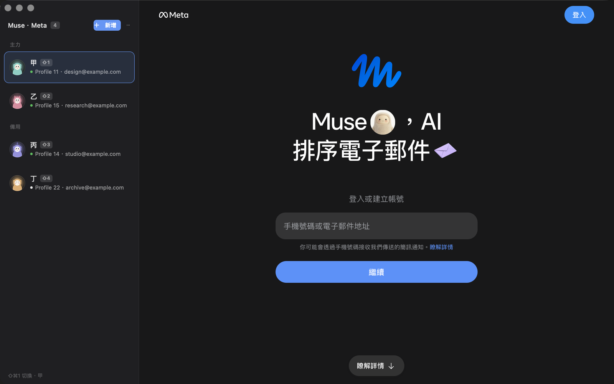

# MuseDock

把多個 [Muse](https://muse.ai) 帳號集中在同一個 macOS 視窗裡切換 —— 每個帳號各自擁有**完全隔離的 Cookie / localStorage / IndexedDB**，互不干擾，不必再開多個瀏覽器 Profile 或反覆登入登出。

純程式碼建 UI，沒有 Xcode 專案、沒有 storyboard、沒有第三方套件，只依賴 Command Line Tools。



- 目前版本：`CFBundleShortVersionString 0.20`（2026-11-28）
- 需求：macOS 14 以上（arm64）、Command Line Tools
- 簽章：ad-hoc，**未公證**——換機器第一次開啟請右鍵 →「打開」
- 資料位置：`~/Library/Application Support/MuseDock/`（詳見 §6）

---

## 0. 一句話

一個視窗、多個 Muse 帳號、各自獨立登入態；切過去就能直接打字貼上，不用管背後是幾個 WebView。

---

## 1. 功能

| 功能 | 說明 |
|---|---|
| 多身分隔離 | 每個帳號一個 `WKWebsiteDataStore(forIdentifier:)`，登入態真正分開 |
| 快速切換 | 側邊欄卡片、全域熱鍵 `⇧⌘1–9`、選單列三種入口 |
| Chrome Profile 匯入 | 直接解密本機 Chrome 的 muse cookie 寫入指定帳號，不用手動匯出 |
| 來源標註 | 卡片副標題顯示 `Profile 11 · 你的 Google 帳號`，看得出資料從哪來 |
| 帳號頭像 | 抽該帳號 AI 夥伴的形象當卡片圖示（Muse 不提供使用者頭像），存成 128×128 快取 |
| 重複帳號偵測 | 匯入前先用來源目錄比對，二次匯入會先問（v0.19）；匯入後再用左側對話列表做指紋，同一個 Muse 帳號出現兩張卡會標 ⚠︎ |
| 登入狀態即時化 | 載入後探測 `/api/me`，cookie 過期會即時反映在圓點與狀態列 |
| 省資源模式 | 切走的帳號閒置 10 分鐘後釋放 WebView，切回自動重建且仍登入 |
| 剪貼板 | `⌘C` / `⌘V` / `⌘X` / `⌘A` / `⌘Z` / `⇧⌘Z` 可用；切換帳號後游標已在輸入框，直接貼得上（v0.16 → v0.17） |
| 選單列常駐 | 關窗不退出，從選單列或熱鍵隨時叫回 |
| 開機自動啟動 | `SMAppService`，可在選單裡勾選 |
| 單一實例 | `flock` 仲裁，連點兩次只會叫回既有視窗，不會兩個行程搶同一份狀態檔 |

---

## 2. 最近更新（v0.19）

**同一個 Chrome Profile 不會再被匯入成兩張卡片——第二次匯入前會先問你。**

| 文件 | 給誰 | 內容 |
|---|---|---|
| [docs/UPDATE-v0.19.md](docs/UPDATE-v0.19.md) | **使用者** | 匯入前的提示長什麼樣、`already=` 怎麼看、升級 |
| [docs/CHANGELOG-v0.19.md](docs/CHANGELOG-v0.19.md) | **開發** | 預檢為什麼放在解密前、純函式文案、基線修復（`activate` 與 key window）、被否掉的方案、回歸清單 |

**升級／回滾各一條**（`accounts.json` 格式沒變，**不需要重新登入**）：

```bash
./tools/update.sh              # 拉最新 → 結束舊的 → 重建 → 重開
./tools/rollback.sh            # 回到上一個版本
./tools/rollback.sh --list     # 看有哪些版本可回
./tools/rollback.sh main       # 回到最新
```

兩支腳本都自己處理「先結束舊實例、等 `instance.lock` 釋放」這一步——漏掉它就會出現
「更新沒生效」的假象（舊行程握著鎖，新行程只會叫回舊視窗然後 `exit(0)`）。

不想切過去游標就跳進輸入框（`open` 不會把環境變數傳給 App，要用 `launchctl`）：

```bash
launchctl setenv MUSE_NO_AUTOFOCUS 1   # 之後每次啟動都生效
pkill -x MuseDock; sleep 1; open -a MuseDock
launchctl unsetenv MUSE_NO_AUTOFOCUS   # 想還原
```

---

## 3. 需求

| 項目 | 要求 |
|---|---|
| 系統 | macOS 14 以上，arm64（`-target arm64-apple-macos14.0` 硬編碼，Intel 需自行改） |
| 工具鏈 | Command Line Tools（`xcode-select --install`），**不需要完整 Xcode** |
| 第三方套件 | 無。只用 AppKit / WebKit / ServiceManagement / libsqlite3 |

---

## 4. 建置與安裝

```bash
git clone https://github.com/sulipa181/MuseDock.git
cd MuseDock
./build.sh
```

`build.sh` 會編譯、打包 `Info.plist`、產生 `AppIcon.icns`、ad-hoc 簽章，最後複製到 `/Applications`。

> ad-hoc 簽章沒有公證，換機器第一次開啟請右鍵 →「打開」。

---

## 5. 使用

1. 開啟 App，側邊欄「⋯」→ **從 Chrome 匯入**，選一個已登入 Muse 的 Chrome Profile
2. `⇧⌘1`～`⇧⌘9` 切換帳號；編號一旦分配就不再重用
3. 關掉視窗不會退出，從選單列圖示或熱鍵叫回；`⌘Q` 才是結束

App 主選單有四張（與狀態列圖示的下拉選單是兩回事）：

| 選單 | 內容 |
|---|---|
| **MuseDock** | 開機自動啟動、結束（`⌘Q`） |
| **編輯** | 復原／重做／剪下／複製／貼上／全選（`⌘Z`／`⇧⌘Z`／`⌘X`／`⌘C`／`⌘V`／`⌘A`） |
| **帳號** | 列出所有帳號，`⇧⌘n` 直接切換 |
| **檢視** | 重新載入（`⌘R`）、在瀏覽器打開（`⌘O`） |

---

## 6. 資料位置

```
~/Library/Application Support/MuseDock/accounts.json     帳號清單（含 storeID、來源、指紋）
~/Library/Application Support/MuseDock/avatars/          卡片頭像快取（刪掉會自動重抓）
~/Library/Application Support/MuseDock/instance.lock     單一實例鎖
~/Library/Application Support/MuseDock/accounts.broken-*.json  accounts.json 讀不懂時的備份（留最近 5 份）
~/Library/Logs/MuseDock.log                              執行日誌（4MB 輪替，留兩份）
~/Library/WebKit/local.sulipa.musedock/WebsiteDataStore/  每個帳號的實際資料
```

排查問題先看日誌：`tail -50 ~/Library/Logs/MuseDock.log`。從 Dock／Finder 啟動時它也會寫，
不必再從終端機開一份。

想跑一份不影響正式資料的實例（假資料、不動真實帳號）：

```bash
MUSE_STATE_DIR=/tmp/md-demo MUSE_DEMO=1 ./MuseDock.app/Contents/MacOS/MuseDock
```

---

## 7. 專案結構

```
main.swift               UI + Controller + 診斷入口（3284 行）
ChromeCookies.swift      Chrome Profile 掃描與 cookie 解密（PBKDF2 + AES-128-CBC）
build.sh                 編譯、打包、簽章、安裝
tools/update.sh          一鍵升級（pull → 結束舊的 → 重建 → 重開）
tools/rollback.sh        一鍵回滾（切版本 → 重建 → 重開）
tools/release.sh         一鍵發版（版本號 → 建置 → commit → tag → Release）
tools/draw_icon.py       程式化繪製 App 圖示
docs/ROADMAP.md          待辦、驗收標準、自動推進規則
docs/UPDATE-v0.19.md     使用者向更新說明
docs/CHANGELOG-*.md      各版本開發向變更說明
docs/DEVELOPER.md        開發說明（架構、流程、踩過的坑、22 條坑、自測入口）
docs/screenshot-demo.png 示範截圖（假資料，非真實帳號）
```

---

## 8. 文件

**使用者向**

- [docs/UPDATE-v0.19.md](docs/UPDATE-v0.19.md) — 最新更新說明：匯入前的重複提示、`already=` 怎麼看、升級

**開發向**

- [docs/ROADMAP.md](docs/ROADMAP.md) — 下一步做什麼、怎麼驗收、自動推進的規則
- [docs/DEVELOPER.md](docs/DEVELOPER.md) — 接手前先看：資料模型、七個核心流程、22 條踩坑紀錄、§8 診斷與自測入口
- [docs/CHANGELOG-v0.19.md](docs/CHANGELOG-v0.19.md) — v0.19：匯入前預檢 + 基線修復（含被否掉的方案、回歸清單）
- [docs/CHANGELOG-v0.18.md](docs/CHANGELOG-v0.18.md) — v0.18：儲存加固與日誌
- [docs/CHANGELOG-v0.17.md](docs/CHANGELOG-v0.17.md) — v0.17：輸入焦點與貼上路徑

**沿革**

| 版本 | 主題 |
|---|---|
| [v0.19](docs/CHANGELOG-v0.19.md) | 匯入前預檢重複帳號（`already=`、`MUSE_IMPORT_PRECHECK`）、基線修復 |
| [v0.17](docs/CHANGELOG-v0.17.md) | 切換帳號後直接 `⌘V` 就能貼（DOM 焦點 / 貼上路徑） |
| [v0.16](docs/CHANGELOG-v0.16.md) | 補「編輯」選單、交還第一響應者 |
| [v0.15](docs/CHANGELOG-v0.15.md) | 卡片頭像（抽 AI 夥伴 `<video>` 一幀） |
| [v0.14](docs/CHANGELOG-v0.14.md) | 省資源模式（閒置 10 分鐘釋放 WebView） |
| [v0.13](docs/CHANGELOG-v0.13.md) | 單一實例鎖（`flock`） |
| [v0.12](docs/CHANGELOG-v0.12.md) | 登入狀態即時化 |

---

## 9. 已知限制

| 限制 | 說明 |
|---|---|
| email 不是 Muse 的 | Muse 前端不暴露登入帳號的 email，卡片上的 email 是**匯入來源的 Chrome Google 帳號** |
| 頭像是 AI 夥伴 | Muse 沒有使用者頭像，卡片顯示的是該帳號 AI 夥伴的形象；形象相同的帳號只能靠名稱與編號區分 |
| 冷啟動樣本不足 | 重複偵測與頭像只能針對「被開啟過」的帳號，剛啟動時未必有樣本 |
| 熱鍵不可自訂 | 固定 `⇧⌘1–9`，與其他 App 衝突時只能改用「帳號」選單或側邊欄卡片 |
| 匯入不預檢 | 同一個帳號匯入兩次不會在匯入前擋下，要等開啟後才標 ⚠︎ |
| 記憶體不自適應 | 只有「閒置 10 分鐘」的固定門檻，不會依記憶體壓力提前釋放 |
| 平台硬編碼 | `arm64 / macOS 14` 寫在 `build.sh`，換 Intel 需改 `-target` |

---

## 10. 聲明

本專案是個人使用的小工具，與 Muse（muse.ai）官方無關；cookie 解密只在本機進行，不會上傳任何資料。
